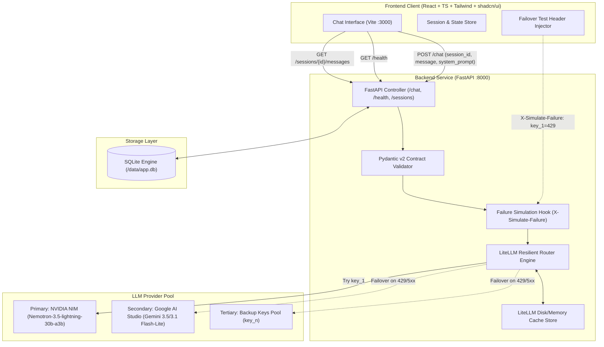

# System Architecture Specification

## 1. High-Level Architecture Overview

This application is an enterprise-grade, resilient LLM Chatbot service featuring automated multi-key provider failover, request-level caching, multi-turn state preservation, and comprehensive telemetry metrics.



---

## 2. Component Design & Responsibilities

### 2.1 Backend Core (FastAPI)
- **Framework**: FastAPI with asynchronous I/O and strict Pydantic v2 schemas.
- **Base Endpoints**:
  - `GET /health`: Verifies SQLite connectivity, LiteLLM key pool readiness, and cache health. Returns `{"status": "ok", "keys_configured": N, "cache_enabled": true}`.
  - `POST /chat`: Orchestrates validation, history retrieval, simulation interception, LiteLLM execution, persistence, and telemetry calculation.
  - `GET /sessions/{session_id}/messages`: Fetches chronological conversation history from SQLite excluding the system prompt.
- **Telemetry & Metadata Engine**:
  - `resolution_source`: Exactly `"LIVE_INFERENCE"` or `"LLM_CACHE"`.
  - `model`: Model name returning response (e.g. `nvidia/nemotron-3.5-lightning-30b-a3b` or `gemini/gemini-3.5-flash-lite`).
  - `latency_ms`: Real server-side round-trip time in milliseconds (wall-clock timing).
  - `input_tokens` / `output_tokens`: Request-specific prompt and completion tokens (never session-accumulated).
  - `key_id`: ID of succeeding key (`key_1`, `key_2`, ...) or `null` if resolved from cache.
  - `fallback_attempts`: Number of failed provider keys prior to success (0 on cache hit).

### 2.2 LLM Gateway, Routing & Caching
- **Primary / Fallback Configuration**:
  - `key_1`: NVIDIA NIM (`nvidia/nemotron-3.5-lightning-30b-a3b` via OpenAI-compatible endpoint `https://integrate.api.nvidia.com/v1`).
  - `key_2`: Google AI Studio (`gemini/gemini-3.5-flash-lite` or `gemini/gemini-3.1-flash-lite` selected from empirical demand report data).
- **Caching Mechanism**:
  - Cache key computed from `model + full conversation context (system prompt + history + current user message)`.
  - Cache hit returns identical reply text, recorded token usage, `key_id = null`, `fallback_attempts = 0`, and latency faster than live calls.
- **Failover & Simulation Hook**:
  - `X-Simulate-Failure`: Injects artificial 429, 500, 502, or 503 failures on specified key IDs when `ENABLE_FAILURE_SIMULATION=true`.
  - Seamless fallback across the provider pool until a successful response is produced. If all keys fail, returns clean `503 {"detail": "all providers unavailable"}` without adding unfulfilled turns to the database.

### 2.3 Storage (SQLite)
- Local embedded database accessed through `DATABASE_URL` (defaulting to `sqlite:////data/app.db`).
- Persistent across container lifecycles via mounted Docker volume at `/data`.
- Schema:
  ```sql
  CREATE TABLE IF NOT EXISTS messages (
    id INTEGER PRIMARY KEY AUTOINCREMENT,
    session_id TEXT NOT NULL,
    role TEXT NOT NULL,
    content TEXT NOT NULL,
    metadata TEXT,
    created_at TEXT NOT NULL
  );
  CREATE INDEX IF NOT EXISTS idx_messages_session_created ON messages (session_id, created_at);
  ```

### 2.4 Frontend Client (React + TypeScript)
- Built with Vite, React 19, Tailwind CSS, and shadcn/ui.
- Session lifecycle: Generates a unique client `session_id` (`s-${uuid}`) on initial mount.
- Contract-compliant `data-testid` DOM attributes:
  - `chat-input`
  - `send-button`
  - `assistant-message`
  - `meta-source`
  - `meta-model`
  - `meta-latency`
  - `meta-input-tokens`
  - `meta-output-tokens`
  - `system-prompt-input`
- Developer/Demo Toolbar: Built-in toggle to simulate key failures (`key_1=429`, `key_1=429,key_2=500`, `*=429`) directly in the UI for effortless 2-3 minute video demonstration.
